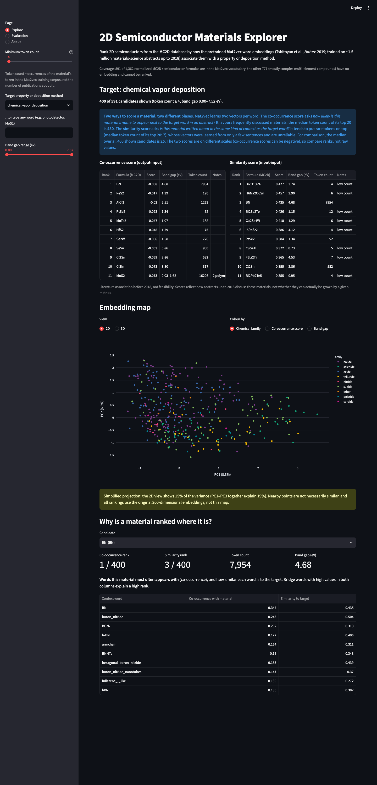
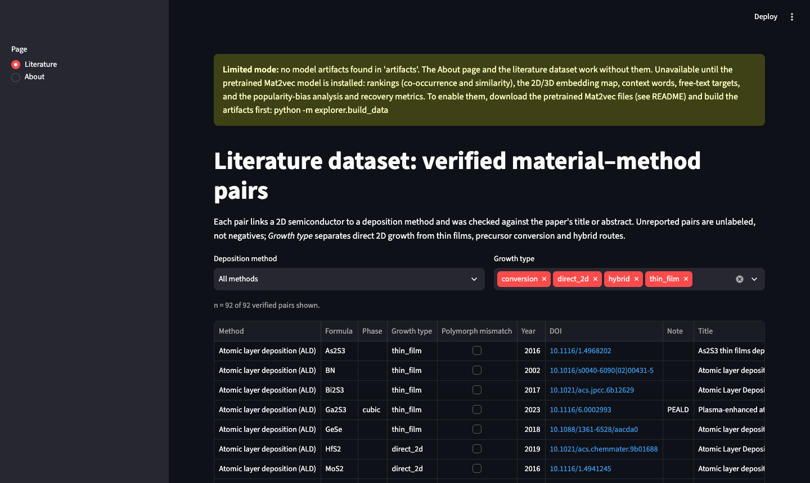

# mat2vec-2d-explorer

An interactive Streamlit dashboard that ranks **2D semiconductors from the MC2D database** against properties and thin-film deposition methods using the **pretrained Mat2vec word embeddings** (Tshitoyan *et al.*, *Nature* 2019). It also measures what those rankings actually capture.

The main finding is a **popularity bias**:
- The paper's co-occurrence score (output·input) favours much-discussed materials for all five deposition methods tested.
- Plain cosine similarity (input·input) favours rare tokens whose vectors are learned from only a handful of sentences.

A verified literature set of 92 material–method pairs supports this as an exploratory, largely in-sample recovery test.

## Tech stack

- **Python 3.11**: NumPy and pandas for scoring, positive-only metrics and PCA (SVD).
- **Streamlit** and **Plotly**: interactive dashboard with 2D/3D charts.
- **gensim** loads the pretrained Mat2vec Word2Vec model (build step only); **pymatgen** handles formula normalization.
- **Data APIs**: MC2D via OPTIMADE; OpenAlex and Crossref for literature curation.
- **Testing**: pytest and Streamlit AppTest (72 tests).

## Relation to Mat2vec

This project builds on [Mat2vec](https://github.com/materialsintelligence/mat2vec): word embeddings trained by Tshitoyan *et al.* on ~1.5 million materials-science abstracts (*Nature* 571, 95–98, 2019, doi:10.1038/s41586-019-1335-8).
- **What it reuses:** the authors' pretrained embeddings, unchanged and never retrained; their formula normalization (`explorer/formula.py`, MIT); and the paper's own output·input scoring. The build step verifies that scoring by reproducing the paper's Fig. 2a ranks.
- **What is new here:** the MC2D 2D-semiconductor candidate set, the five-method literature evaluation, the popularity-bias analysis and the dashboard.

> **What this is not.** Scores reflect how abstracts published up to 2018 discuss these materials. They are **not** predictions of deposition feasibility, film quality or processing conditions.

| Explore | Evaluation |
|---|---|
|  |  |

More screenshots: [3D embedding map](docs/screenshots/explore3d.png), [About page](docs/screenshots/about.png), [limited mode](docs/screenshots/limited.png).

## Features

- **Explore**
  - Pick a property or deposition method, or type any vocabulary word. Ranked candidates appear in two side-by-side tables, co-occurrence (out·in) and similarity (in·in), with MC2D band gaps.
  - One **minimum-token-count slider** filters both rankings. Its default is count > 3, the paper's filter, and it goes down to 1 to include rare materials. The page shows how many candidates remain.
  - A plain-language box explains the two scores, with live popularity numbers (median token count of each top 20).
  - **2D/3D PCA map** in Plotly, coloured by chemical family, score or band gap. Axes show explained variance, and a warning notes that PC1–3 explain only ~19% of the variance. Rankings always use the full 200-dimensional vectors.
  - **"Why is it ranked here?"** panel: both ranks, token count, low-count/polymorph badges, and the context words that bridge the material and the target.
- **Evaluation**
  - The popularity-bias analysis comes first. It needs no labels.
  - It is followed by an exploratory literature-association recovery test across five methods:
    - positive-only metrics (Recall@20, median percentile rank);
    - a token-frequency baseline;
    - listed vs eligible positive counts;
    - a direct-2D toggle with insufficient-data notices;
    - a growth-route breakdown;
    - DOI-linked references.
- **About:** sources, licences and scientific limitations.
- **Runs out of the box:** the repository includes the precomputed `artifacts/` (44 MB), so the hosted app and a fresh clone have every feature, including free-text queries, without downloading the ~880 MB model. Fallbacks: a results-only bundle (15 predefined targets) if `artifacts/` is missing, then limited mode (About and Literature).
- Shareable links: `?page=Evaluation`, `?view=3D`.

## Results

All numbers use the default filter (token count ≥ 4): **400 of 591** candidates.

### Main finding: opposite popularity biases (no labels needed)

Spearman correlation between each score and log token count:

| Method (Mat2vec token, corpus count) | Co-occurrence (out·in) | Similarity (in·in) |
|---|---|---|
| CVD (`chemical_vapor_deposition`, 11,680) | **+0.58** | −0.19 |
| ALD (`ALD`, 5,072) | **+0.64** | −0.04 |
| MBE (`molecular_beam_epitaxy`, 5,616) | **+0.35** | −0.39 |
| Magnetron sputtering (`magnetron_sputtering`, 7,948) | **+0.49** | −0.21 |
| PLD (`pulsed_laser_deposition`, 6,520) | **+0.45** | −0.35 |

For CVD, the median token count of the co-occurrence top 20 is **450**. For the similarity top 20 it is **7**, against **25** for all 400 candidates.

### Supporting evidence: exploratory literature-association recovery

**92 unique, manually verified material–method pairs** were used. Each one has a DOI and a growth route: direct 2D growth, thin film, precursor conversion or hybrid. **63 of the 92 papers were published by 2018 and may overlap Mat2vec's training corpus**, so this is largely in-sample: it shows that known literature associations are encoded, not that new pairs can be predicted.

All verified pairs (eligible positives = listed pairs: every listed material passes the count filter). Each cell reads out·in / in·in / token-count baseline:

| Method | Eligible positives (n) | Recall@20 | Median percentile rank (50 = chance) |
|---|---|---|---|
| CVD | 26 | **0.46** / 0.12 / 0.12 | **6.2** / 21.9 / 18.4 |
| ALD | 17 | 0.12 / 0.12 / **0.18** | **9.8** / 25.0 / 16.5 |
| MBE | 18 | **0.39** / 0.17 / 0.11 | **8.1** / 28.9 / 14.0 |
| Magnetron sputtering | 13 | **0.54** / 0.00 / 0.23 | **5.0** / 18.2 / 11.0 |
| PLD | 18 | **0.33** / 0.00 / 0.17 | **6.9** / 32.6 / 12.1 |

Direct 2D growth only, with polymorph-mismatched pairs excluded:

| Method | Eligible positives (n) | Recall@20 | Median percentile rank |
|---|---|---|---|
| CVD | 14 | **0.50** / 0.14 / 0.21 | **4.4** / 16.4 / 15.8 |
| MBE | 10 | **0.40** / 0.20 / 0.20 | **8.1** / 34.6 / 13.4 |
| ALD, PLD, sputtering | 6, 5, 0 | insufficient data (< 10) | insufficient data |

How to read it:
- Co-occurrence ranks known pairs higher than popularity alone for every method by median percentile, and for 4 of 5 by Recall@20.
- Similarity does worse than the popularity baseline everywhere.
- Positive sets are small, so differences between methods are indicative, not conclusive.

## Scientific limitations

- Mat2vec encodes literature relationships up to 2018, not proven deposition feasibility. Higher similarity does not mean better film quality or optimal conditions.
- Unreported material–method pairs are **unlabeled, not negatives**. Only positive-only metrics are reported.
- Some verified papers report thin films, post-deposition conversion (e.g. selenizing a sputtered W film), hybrid routes, or a different polymorph from the MC2D entry. Five pairs are flagged `phase_mismatch` and excluded from the direct-2D analysis: 1T′ MoTe2 and WTe2, rock-salt SnSe, cubic BN.
- Coverage: only **591 of 1,362** normalized MC2D semiconductor formulas are in the Mat2vec vocabulary. Polymorphs sharing a formula are merged, and MC2D band gaps are DFT values.
- PCA shows ~19% of the variance and is for display only.

## Quickstart

### 1. Install

```bash
conda create -n mat2vec-explorer python=3.11 -y
conda activate mat2vec-explorer
pip install -r requirements.txt          # the app
pip install -r requirements-build.txt    # tests, and rebuilding artifacts/ from the model
```

### 2. Run the app (full version, no model download)

```bash
streamlit run explorer/app.py            # open http://localhost:8501
```

The repository includes `artifacts/` (four files, 44 MB), so every feature works straight away: rankings for any of the 15 predefined targets **or any word in the 50,482-token table** (free-text queries), the side-by-side comparison, the 2D/3D map, context words, Evaluation and About.

Fallbacks, used automatically:
1. **Results-only version:** if `artifacts/` is missing, the app uses `public_artifacts/`, a 1.7 MB bundle of plain CSV files. It holds precomputed, limited-scope outputs (scores for the 15 predefined targets, PCA coordinates, candidate metadata, top-10 context words), not the embedding vectors, so free-text queries are unavailable. It also adds a Literature page.
2. **Limited mode:** if both are missing, only the About page and the literature dataset are shown, with a notice naming the missing features.



### 3. Optional: rebuild `artifacts/` from the pretrained model

1. Download the three model files (~880 MB) from the original authors' storage. These are the same files the original mat2vec `setup.py` downloads:
   - https://storage.googleapis.com/mat2vec/pretrained_embeddings
   - https://storage.googleapis.com/mat2vec/pretrained_embeddings.wv.vectors.npy
   - https://storage.googleapis.com/mat2vec/pretrained_embeddings.trainables.syn1neg.npy

   A [mat2vec](https://github.com/materialsintelligence/mat2vec) checkout next to this repo works with no configuration (default path `../mat2vec/mat2vec/training/models`). Otherwise set `MAT2VEC_MODEL_DIR` to the files' folder.

   > **Licence:** these files are by Tshitoyan *et al.* and are distributed under the mat2vec MIT License (Copyright (c) 2019 Authors of Tshitoyan et al. Nature (2019)); redistribution of the pretrained weights was confirmed by first author Vahe Tshitoyan via email in October 2026. You only need them to rebuild `artifacts/`.

2. Build the artifacts and run the app:

   ```bash
   python -m explorer.build_data          # ~10 s; downloads MC2D once, rewrites artifacts/ (~44 MB)
   python -m explorer.public_bundle       # refresh the results-only fallback
   streamlit run explorer/app.py
   ```

   `build_data` checks itself:
   - it reproduces the paper's Fig. 2a ranks (Li2CuSb 326, Cu3Nb2O8 345);
   - it verifies that the float16 artifacts give the same rankings as the full model (Spearman 0.999999 for both modes).

   Both results are recorded in `artifacts/meta.json`.

### Tests

```bash
pytest                                   # 72 tests; artifacts/ ships with the repo, so all of them run (they skip with a reason if it is removed)
```

### Troubleshooting

| Message | Fix |
|---|---|
| "Limited mode: no model artifacts found" | Both `artifacts/` and `public_artifacts/` are missing. Restore them from the repository, or follow step 3. |
| "Pretrained Mat2vec model not found in …" | Download the three files and set `MAT2VEC_MODEL_DIR`. |
| "The build step needs gensim and pymatgen" | `pip install -r requirements-build.txt` |
| `ModuleNotFoundError: streamlit` / `plotly` | `pip install -r requirements.txt` |

## Deploying (Streamlit Community Cloud)

Choose these in the deploy screen; the Python version and entrypoint are not read from the repository:
- **Repository / branch:** `xua1ex/mat2vec-2d-explorer`, `main`
- **Main file path:** `explorer/app.py`
- **Advanced settings → Python version: Python 3.11** (the platform default is 3.12; the app is tested on 3.11)
- **Dependencies:** the root `requirements.txt` (the six runtime packages) is the only dependency file Community Cloud finds. `requirements-build.txt` is not installed, so neither gensim nor the model is needed on the server.

The deployed app reads the committed `artifacts/` and runs the full version, free-text queries included. The ~880 MB model is never needed on the server.

## Architecture

```
explorer/
  formula.py      formula normalization adapted from mat2vec (WS2 -> S2W), + isotope guard for new pymatgen
  build_data.py   offline: pretrained model + MC2D (OPTIMADE) -> artifacts/ (vectors.npz, candidates, PCA coords, meta)
  ranking.py      numpy/pandas only: both scores, ranks, context words, popularity bias, positive-only metrics
  public_bundle.py artifacts/ -> public_artifacts/: results-only bundle for the hosted version (no vectors)
  app.py          Streamlit UI (Explore / Evaluation / About, + Literature when hosted); no gensim at runtime
artifacts/        vectors.npz (embedding subset, float16), candidates, PCA coords, meta (44 MB; full version)
public_artifacts/ precomputed scores, PCA coordinates, candidate metadata, context words (CSV, ~1.7 MB; fallback)
data/
  known_methods.csv   92 verified material–method pairs (DOI, growth type, phase, evidence, notes)
tools/
  find_literature.py  OpenAlex/Crossref candidate search used to build known_methods.csv (provenance)
                      (set LITERATURE_MAILTO=<your email> first: OpenAlex/Crossref polite pool)
tests/            formula, ranking, build, literature-set integrity, Streamlit AppTest (72 tests)
docs/             design spec, implementation plan, screenshots
```

How the pieces fit together:
- **Runtime:** the app needs only `requirements.txt` (streamlit, pandas, numpy, scipy, plotly, pyarrow; scipy is used by pandas for Spearman correlations).
- **Build time:** the build step adds gensim, pymatgen and requests.
- **Scoring:** both modes come from one `score()` function. Co-occurrence passes the materials' output vectors, similarity passes their input vectors.

## Data and provenance

- **Mat2vec**: Tshitoyan, V. *et al.* *Nature* 571, 95–98 (2019), doi:10.1038/s41586-019-1335-8.
  - The pretrained embeddings are used unchanged. The four derived files in `artifacts/` are distributed under the mat2vec MIT License; redistribution of the pretrained weights was confirmed by first author Vahe Tshitoyan via email in October 2026. The original ~880 MB model files are not included.
- **MC2D**: Mounet, N. *et al.* *Nat. Nanotechnol.* 13, 246 (2018), doi:10.1038/s41565-017-0035-5; Campi, D. *et al.* *ACS Nano* 17, 11268 (2023). Formulas and band gaps come from the public OPTIMADE API, licence CC BY 4.0. The raw response is cached in `data/mc2d_raw.json` (git-ignored).
- **Literature set**: candidates came from OpenAlex. Crossref was used for sputtering and PLD after the OpenAlex free quota ran out. Each row was then reviewed by hand against its title or abstract. Rejected rows included papers where the material is only a substrate ("ALD of HfO2 on MoS2"), a precursor or an MBE source, and subscript artifacts.
- **Licences**:
  - This project's source code is released under the MIT License ([LICENSE](LICENSE)). `explorer/formula.py` is adapted
    from mat2vec (MIT). MC2D data is CC BY 4.0. Full notices: [THIRD_PARTY_NOTICES.md](THIRD_PARTY_NOTICES.md).
  - **The pretrained Mat2vec embeddings are distributed under the mat2vec MIT License** (Copyright (c) 2019 Authors of Tshitoyan et al. Nature (2019)).
    Redistribution of the pretrained weights under the MIT License was confirmed by first author Vahe Tshitoyan via email in October 2026.
    This repository ships the four derived files in `artifacts/` (44 MB, including `vectors.npz`) under that licence;
    the raw model files (`pretrained_embeddings*`, `*.npy`, ~880 MB) are not included and stay git-ignored.
  - `public_artifacts/` contains **precomputed, limited-scope outputs derived from Mat2vec**, kept as a fallback for
    when `artifacts/` is unavailable; it is distributed under the same licence.

## How to cite

If you use this project, please cite the work it builds on:
- Tshitoyan, V. *et al.* Unsupervised word embeddings capture latent knowledge from materials science literature. *Nature* 571, 95–98 (2019). doi:10.1038/s41586-019-1335-8
- Mounet, N. *et al.* Two-dimensional materials from high-throughput computational exfoliation of experimentally known compounds. *Nat. Nanotechnol.* 13, 246–252 (2018). doi:10.1038/s41565-017-0035-5
- Campi, D. *et al.* Expansion of the Materials Cloud 2D Database. *ACS Nano* 17, 11268–11278 (2023). doi:10.1021/acsnano.2c11510
